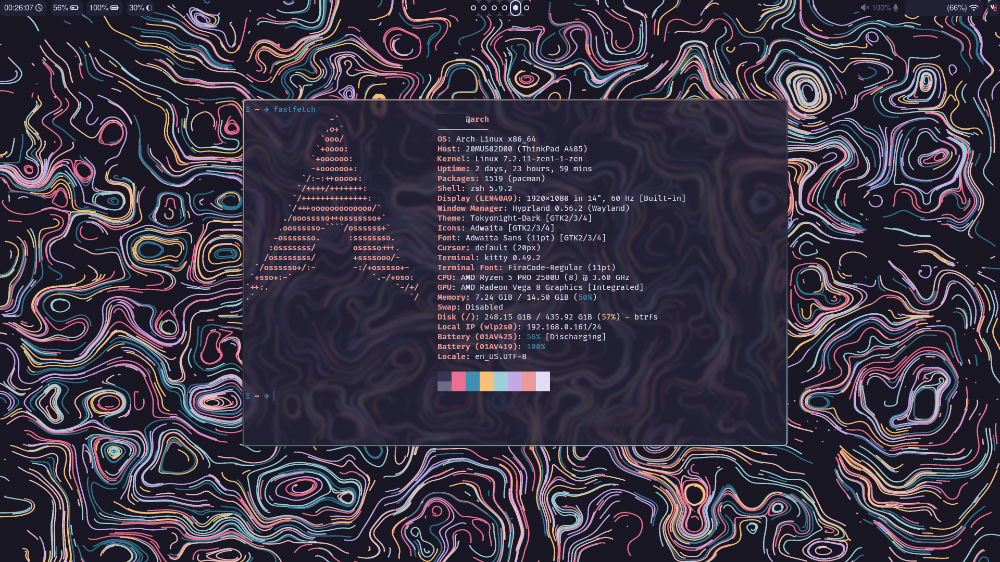
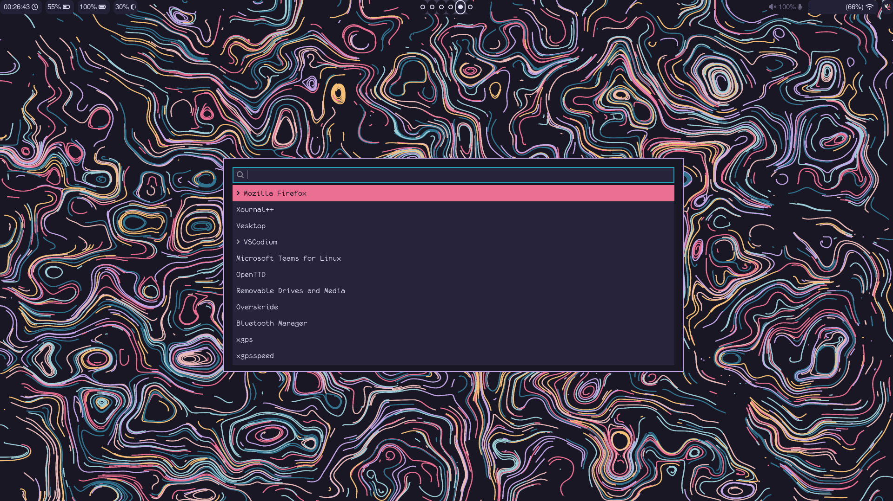
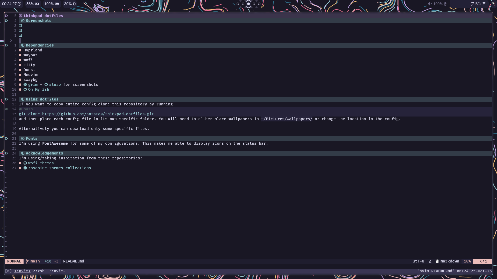

# thinkpad dotfiles
## Screenshots




## Dependencies
- Hyprland
- Waybar
- Wofi
- kitty
- Dunst
- Neovim
- swaybg
- [grim](https://sr.ht/~emersion/grim/) + [slurp](https://github.com/emersion/slurp) for screenshots
- [Oh My Zsh](https://github.com/ohmyzsh/ohmyzsh)

## Using dotfiles
If you want to copy entire config clone this repository by running
```bash
git clone https://github.com/antste0/thinkpad-dotfiles.git
```
and then place each config file in its own specific folder. You **will** need to either place wallpapers in `~/Pictures/wallpapers/` or change the location in the config.

Alternatively you can download only some specific files.

## Fonts
I'm using **FontAwesome** for some of my configurations. This makes me able to display icons on the status bar.

## Acknowledgements
I'm using/taking inspiration from these repositories:
- [wofi themes](https://github.com/joao-vitor-sr/wofi-themes-collection)
- [rosepine themes collections](https://rosepinetheme.com/themes/)
